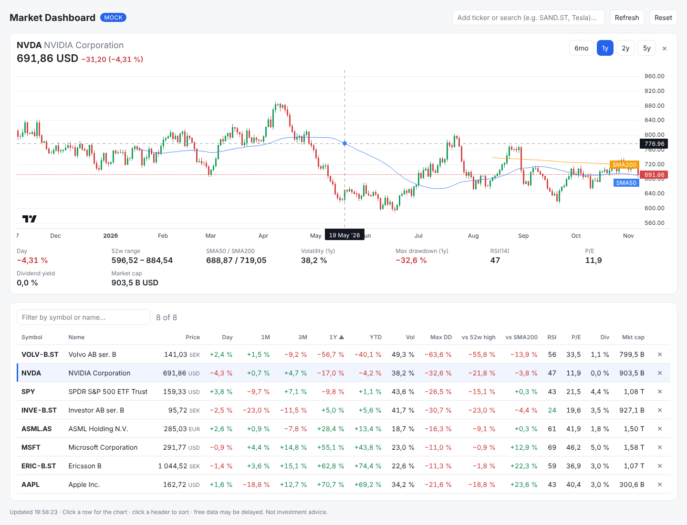
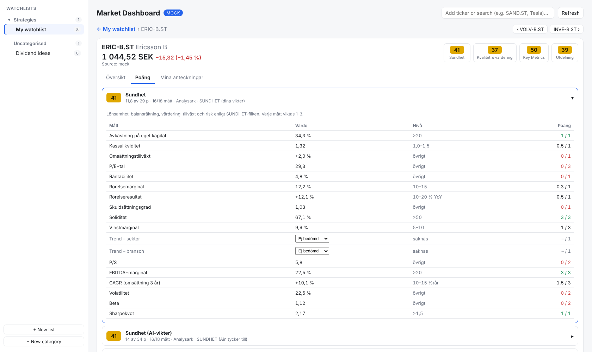

# Market Screener

A stock watchlist and analysis dashboard that pulls data from free market-data APIs. Add any tickers (Stockholm, US, Europe…), sort and filter the list by returns, risk and valuation metrics, and open a candlestick chart with moving averages for each one.

**[Try the demo →](https://screener.godvig.com/)** (made-up prices, runs entirely in your browser)





## Features

- **Sidebar with categories.** Group watchlists into categories, drag lists between categories and drag categories to reorder them. Double-click to rename. Everything is saved on the server in `data/store.json`, with a backup copy in the browser. Export/import lists as JSON
- **Scorecards.** Nine scoring models (Sundhet with two weight profiles, Kvalitet & värdering, Key Metrics, Utdelning, Utdelningspoäng, Tillväxt, Tillväxt graderad, Egen bedömning) shown as sortable 0–100 columns with coverage (e.g. `16/18` metrics had data). Points are blended smoothly between tiers, and a score is only shown when enough of the scorecard has data. The stock page breaks every score down per criterion: value, tier and points
- **Traffic lights.** Green / yellow / red dots on each key figure, using the spreadsheet's icon-set thresholds (toggle in the column picker)
- **Bring your own data.** Import key figures from a CSV or Excel file, such as an export from Börsdata's screener, to fill the scorecards with 5- and 10-year growth and the rest without an API key. Columns are recognised by name (Swedish and English), you check the converted values in a preview, rows are matched to your stocks by ticker or name, and the mapping is remembered so the next export imports in one click. Imported figures stay on your machine. See [Importing key figures](#importing-key-figures-csv--excel)
- **Own notes and assessments per stock.** Sector, niche, country, free-text notes and 0–3 assessments (outlook, management, insiders, sector trend…) that feed the manual criteria. Stored only in `data/store.json` on your machine
- **Works on your phone.** Watchlists open from a ☰ drawer, list actions sit behind ⋯, the table keeps the symbol (with name and horse) pinned while you swipe through the other columns, and dialogs and the column picker fill the screen
- **Arrange the table your way.** Drag a column header to move it (Symbol and Name are locked and stay in view when you scroll sideways). Long headers wrap. The mouse wheel moves the table sideways when the pointer is on the header row, or anywhere in the table once the page has nothing left to scroll; Shift + wheel always works
- **Data coverage at a glance.** The column picker shows, per column, how many percent of the current list has a value, and a header is flagged when under 60 % of the list has data
- **Column picker.** Choose which columns to show: standard price/return/risk columns, then — right of a divider — extra key figures (dividend yield, payout ratio, dividend/share, P/E, forward P/E, P/S, P/B, EV/EBIT, EV/EBITDA, market cap, ROE, ROIC, profit margin, revenue growth, net debt/EBITDA, beta)
- **Sortable, filterable table.** Price, day change, 1M/3M/1Y/YTD returns, volatility, max drawdown, distance from the 52-week high, price vs SMA200, RSI(14), P/E, dividend yield, payout ratio and market cap
- **Original and SEK side by side.** Price, market cap, dividend per share and 52-week range are shown in the listing currency *and* converted to your base currency (`BASE_CURRENCY`, default SEK). Market cap sorts on the converted value, so it's comparable across markets
- **Stock view.** Its own page with a breadcrumb (`List › Ticker`): click the list name, press Esc or use the browser's back button to return; ← / → steps through the list. Candlestick chart (6 mo – 5 y) with SMA50/SMA200 and every key figure available
- **Ticker search** with autocomplete. The watchlist is saved in the browser
- **Pluggable data providers.** Choose Yahoo Finance, Finnhub, Financial Modeling Prep or offline mock data with one env variable
- **Quota-friendly.** A server-side cache (memory and disk) keeps you inside free-tier limits, and API keys never reach the browser
- **Analysis runs locally.** Every metric is computed from daily closes in `shared/analysis.ts`, which has unit tests

## Quick start

```bash
npm install
cp .env.example .env      # PROVIDER=yahoo works without a key
npm run dev               # web on http://localhost:5173, API on :8787
```

Run `npm run dev:mock` for offline demo data.

### Static demo

`VITE_DEMO=1 npm run build` builds a version that needs no server: prices and key figures come from the same deterministic fake data as `PROVIDER=mock`, computed in the browser, and lists are saved in `localStorage`. Every push to `main` publishes it to GitHub Pages via `.github/workflows/demo.yml`.

## Scorecards

Defined in [`shared/scoring.ts`](shared/scoring.ts) as data (criteria → tiers → points), so new models are a few lines. The presets start from the original spreadsheet formulas. Tests in `shared/scoring.test.ts` check them against the spreadsheet's results for a real row, using the "exactly like Excel" settings (`EXCEL_SCORING`).

### Two things the app does differently from the spreadsheet

Both are on by default and can be changed under **Columns ▾**.

**1. Smooth scores instead of steps.** In the spreadsheet, P/E 14.9 gets 2 points and P/E 15.1 gets 1: a whole tier for a rounding error. With *Smooth scores* on, points are interpolated in a straight line between the tiers:

| P/E (≤10 → 3, ≤15 → 2, ≤20 → 1, above → 0) | 5 | 10 | 12.5 | 14.9 | 15.1 | 17.5 | 20 | 25 |
|---|---|---|---|---|---|---|---|---|
| Stepped (spreadsheet) | 3 | 3 | 2 | 2 | 1 | 1 | 1 | 0 |
| Smooth | 3 | 2.5 | 2 | 1.52 | 1.48 | 1 | 0.5 | 0 |

How the line is drawn: every tier gets one anchor point. A tier between two thresholds is anchored at its midpoint (so the middle of a tier scores exactly what the spreadsheet gives). The best and the worst tier are anchored half a neighbouring step beyond their threshold and are flat after that. The line therefore crosses each threshold halfway between the two tiers, and on average a smooth score is neither higher nor lower than the stepped one.

Some edges stay hard on purpose, because a blend would be wrong:

- **Losses and negative equity** (negative P/E, P/B, PEG, P/S, D/E): a loss is not "almost a low P/E".
- **No dividend** (Key Metrics) and a **payout ratio under 5 %**: not "almost a small dividend".
- **Own assessments** (0–3) and other levels or counts: they are discrete.

A criterion with a single threshold (e.g. growth ≥ 10 % in *Tillväxt*) gets half its points on the threshold and ramps from 7.5 % to 12.5 % (a quarter of the threshold on each side).

**2. Minimum coverage.** A score is "points scored ÷ points available on the criteria that had data". That is fair when one or two figures are missing, but with 8 of 18 figures a company can show 70 on thin evidence. So:

- Coverage is measured **by points, not by number of criteria**: a criterion with weight 3 counts three times as much as one with weight 1.
- If less than **60 %** of the scorecard's points have data, **no score is shown**. The badge is greyed out (`–` with e.g. `6/18`), the row sorts last, and the tooltip and the stock page say what the score would have been on the figures that exist.
- The limit can be set to 40, 50, 60, 75 or 90 %, or switched off.

### Which scorecards can the data sources fill?

Best case per source: the share of each scorecard's points that the source *can* deliver. Real coverage is lower for banks, investment companies and small caps, where some figures don't exist. The column picker shows the actual numbers for your list. The Börsdata column assumes every key figure is matched by name; that has only been tested against a simulated API so far.

| Scorecard | Yahoo | Börsdata | What Yahoo lacks |
|---|---|---|---|
| Sundhet (both weight profiles) | 94 % | 94 % | – (the rest is your own two trend assessments) |
| Kvalitet & värdering | 100 % | 100 % | – |
| Key Metrics | 100 % | 100 % | – |
| Utdelning | 75 % | 100 % | 5- and 10-year earnings growth |
| Utdelningspoäng (tillväxt) | 75 % | 100 % | 5- and 10-year earnings growth |
| Tillväxt | 44 % | 100 % | every 5- and 10-year figure except dividends |
| Tillväxt (graderad) | 51 % | 100 % | every 5- and 10-year figure except dividends |
| Egen bedömning | – | – | your own assessments only |

A file import fills whatever columns the file has: a Börsdata screener export with the 5- and 10-year growth columns reaches the Börsdata column above without an API key (see [Importing key figures](#importing-key-figures-csv--excel)).

Yahoo publishes about four years of annual statements, which gives 1- and 3-year growth; dividend history goes back further, so dividend growth has all horizons. The two *Tillväxt* scorecards therefore stay greyed out on Yahoo data at the default 60 % limit. They need Börsdata (which calculates 1-, 3-, 5- and 10-year CAGR), or a lower limit.

### Other deliberate changes from the spreadsheet

- **Losses and negative equity** score 0 instead of landing in the best tier.
- **Two formula typos fixed** in *Utdelning*: the "dividend yield > 2 %" tier and 10-year dividend growth now count.
- **Sundhet**: each criterion scores 0–1 by its tiers and is multiplied by its weight (1–3), so both weight profiles share the same thresholds.
- **Key Metrics**: qualitative tiers ("positive and growing FCF") are expressed as numbers, listed in the breakdown.

Metrics, Swedish names, descriptions and traffic-light thresholds live in [`shared/metrics.ts`](shared/metrics.ts); `ruleSource` marks which thresholds come from the spreadsheets and which are defaults.

## Importing lists

**Import** (above the table) accepts an exported list file or an import bundle:

```json
{
  "format": "market-dashboard-import",
  "version": 1,
  "lists": [{ "name": "Dividend", "group": "Spreadsheet 2024", "symbols": ["INVE-B.ST", "VOLV-B.ST"] }],
  "stocks": { "INVE-B.ST": { "name": "Investor B", "sector": "Finance", "niche": "Asset management", "country": "Sweden" } }
}
```

Categories are matched by name, and existing notes are never overwritten. Tickers that don't load show **Find ticker**, which searches by company name and swaps the ticker in every list.

## Importing key figures (CSV / Excel)

**Import** also takes a table of key figures: `.csv` (semicolon, comma or tab separated) or `.xlsx` / `.xls` / `.ods`. The file type is read from the content, not the name. This is how you get Börsdata-quality figures into the scorecards with only a membership, not an API key: the app never ships or shares any data, it reads the file you exported for your own analysis.

1. **Columns.** Each column is matched to a key figure by its header, using the synonym table in [`shared/importSynonyms.ts`](shared/importSynonyms.ts) (Swedish and English; case, å/ä/ö, spacing, units like "(MSEK)" and "5 år"/"5år"/"5y" don't matter). Change or remove any mapping, and pick which column identifies the company: ticker, name or ISIN. The preview shows the first five rows *after* conversion, in the app's units.
2. **Numbers.** Decimal comma or point, spaces / non-breaking spaces as thousands separators, `%`, a Unicode minus and `(12)` for negatives. `-`, `n/a` and empty cells are missing, never zero.
3. **Scales**, detected per column the same way as for Börsdata's API: percentages written as fractions (`0,045`) are multiplied by 100, market cap under 10 million is read as millions (MSEK). A unit in the header or a `%` in the cells wins over the guess, and you can override each column in the preview.
4. **Stocks.** Rows are matched to the stocks in your lists by ticker (Börsdata/Nordnet style `VOLV B` → `VOLV-B.ST`, also trying `.OL`, `.CO`, `.HE`; pick the exchange for bare tickers), then exact company name, then a similar name, which you are asked to check (different share classes never match). Rows that don't match can be skipped, searched for, or added under the file's ticker; optionally all imported stocks go into a new list.
5. **Saving.** Figures are saved per stock with their source (`import: <file name>`) and date in `data/store.json` (in the demo: in your browser), apart from the providers' data. The column mapping is saved per set of headers, so the next export from the same screener opens on the last step and imports in one click.

**Which value wins:** an imported figure overrides the API for that figure until the import is older than a limit you choose in the dialog (default 120 days). After that the API's value wins where it has one, and the import only fills gaps. The stock page's score breakdown shows the source of every value, and imported values have a small **i** in the table. *Forget all imported figures* in the dialog removes them.

**Try it** with the made-up export in [`docs/examples/borsdata-screener-sample.csv`](docs/examples/borsdata-screener-sample.csv) (in the demo: *Try sample import*). Its companies don't exist, so tick *Also create a list* to see them.

### Exporting from Börsdata

*These steps are a description, not yet checked step by step against Börsdata's current interface.* In Börsdata's screener, add the key figures you want as columns, for example *Direktavkastning*, *Utdelningsandel*, *P/E*, *EV/EBIT*, *ROE*, *ROIC*, *Soliditet*, *Nettoskuld/EBITDA* and the 5- and 10-year growth figures, filter to the companies you follow, and export to Excel. Import that file as it is. Börsdata's terms allow the data for your own analysis only: keep the export on your own machine and don't share it or publish a site that shows it (see *Data and terms of use*). `.gitignore` ignores `.csv`/`.xlsx` files outside `docs/examples/`, so an export saved in the project folder isn't committed by mistake.

### Verified column names

The synonyms come from Börsdata's KPI names in the API and the spreadsheets. **None has been checked against a real Börsdata screener export yet.** When an export confirms a header, it is added to `VERIFIED_HEADERS` in `shared/importSynonyms.ts` and listed here.

| Source | Verified headers |
|---|---|
| Börsdata screener export | – (not verified yet) |

## Checking that live data works

```bash
npm run check                    # VOLV-B.ST, INVE-B.ST, AAPL, KO
npm run check -- SAND.ST ASML.AS # your own tickers
```

For each ticker this prints the quote, exchange rate, every key figure each provider returns, and one year of history, with ✔ or ✘ per step. With `PROVIDER=borsdata` it's the quickest way to confirm your API key and the KPI mapping work. Compare a few figures with Avanza, Nordnet or finance.yahoo.com.

## Data providers

| `PROVIDER` | Key | Free limits (check provider docs) | Coverage | Notes |
|---|---|---|---|---|
| `borsdata` | `BORSDATA_API_KEY` | 100 calls/10 s, aim < 10 000/day | Nordic (+ global with Pro+) | Official Börsdata API, needs Pro+. Uses the Yahoo ticker stored on each Börsdata instrument, so your tickers stay the same. KPI ids are found by name from `/instruments/kpis/metadata` (override with e.g. `BORSDATA_KPI_PE=2`) |
| `yahoo` (default) | none | unofficial, no published limit | global incl. `.ST`, `.AS`, `.DE` | Uses [`yahoo-finance2`](https://github.com/gadicc/yahoo-finance2). Not an official API, so it can break or throttle |
| `finnhub` | `FINNHUB_API_KEY` | ~60 calls/min, personal use | mainly US | Quotes, profile and metrics. History falls back to Yahoo |
| `fmp` | `FMP_API_KEY` | 250 requests/day, EOD data | mainly US | Uses the `stable` API |
| `mock` | none | – | demo symbols | Deterministic random walks for development |

Exchange rates come from [Frankfurter](https://frankfurter.dev) (ECB reference rates, free, no key, updated once per working day – the same rates the Riksbank publishes), with Yahoo currency pairs (`USDSEK=X`) as a fallback. Listings quoted in pence (`GBp`) are converted to pounds first.

**Fallback per ticker:** when the chosen provider doesn't have a ticker (say, an ETF that Börsdata lacks), the quote and history come from Yahoo instead, and key figures missing from the main provider are filled in from Yahoo. The stock view shows which source delivered the price.

### Data and terms of use

This repository contains code only: no market data is stored in it or shipped with it. The app fetches data on your machine, with your own access, and you are responsible for following each source's terms:

- **Yahoo Finance** has no official public API. `yahoo-finance2` uses the same endpoints as the website, and Yahoo's terms allow personal use only.
- **Börsdata** allows API data for your own analysis only: no commercial use, no sharing of the data and no websites or widgets that show it to others. A key requires a paid membership. The same goes for files you export from Börsdata and import here: they stay in your own `data/store.json` (or your browser, in the demo) and are never sent anywhere else. The public demo contains only made-up figures.
- **Finnhub** and **Financial Modeling Prep** free plans are for personal use; showing their data to others needs a separate licence.

Nothing here is investment advice. The scores are arithmetic on reported figures, by rules you can read and change.

To add another source, implement `MarketProvider` in `server/providers/` and register it in `server/providers/index.ts`.

## Project layout

```
server/            Express API (proxy, cache, providers, FX, storage)
  providers/       yahoo · borsdata · finnhub · fmp · mock adapters
shared/            Types + analysis functions (used by server and client)
  import*.ts       file import: reading, synonyms, matching, merge rules
docs/examples/     made-up sample export for the import
src/               React client (Vite, TanStack Table, lightweight-charts)
  columns.tsx      every table column in one registry
```

## Scripts

| Command | What it does |
|---|---|
| `npm run dev` | API + Vite dev server with hot reload |
| `npm run dev:mock` | Same, with offline mock data |
| `npm test` | Unit tests for the analysis functions |
| `npm run typecheck` | TypeScript check |
| `npm run build && npm start` | Production build served by the API on :8787 |

## Notes on the metrics

- **Vol** (volatility) is how much the price swings: the annualised standard deviation of daily log returns over one year. 20 % means the price typically moves about ±20 % a year around its trend.
- **Div yield** (direktavkastning) is the annual dividend divided by the share price. Yahoo's forward yield is used when available, otherwise the trailing yield.
- **Payout** (utdelningsandel) is the share of earnings paid out as dividends. Above 100 % (shown in red) means the company pays more than it earns, which is usually not sustainable.

- Returns use trading-day lookbacks: 21 for 1M, 63 for 3M, 126 for 6M and 252 for 1Y.
- Max drawdown is the largest peak-to-trough fall within the last year.

## Roadmap ideas

- [x] Currency conversion to SEK next to the original values
- [ ] Compare view: the same metric from several providers side by side
- [x] Multiple named watchlists with JSON export/import
- [ ] CSV export of the table
- [ ] Compare view: normalised performance of several tickers on one chart
- [ ] Screener: filter rules like "RSI < 30 and above SMA200"
- [ ] Fundamentals tab (revenue, margins, cash flow) from FMP
- [ ] Deploy (e.g. Fly.io / Render) with a public demo running in mock mode

---

Your lists, notes, assessments and imported key figures are saved only in `data/store.json` (git-ignored) and never leave your machine.

Data from free sources may be delayed or inaccurate. This is not investment advice.

## License

[MIT](LICENSE) © Adam Englund. The license covers the code only; market data is subject to each provider's own terms (see *Data and terms of use*).
